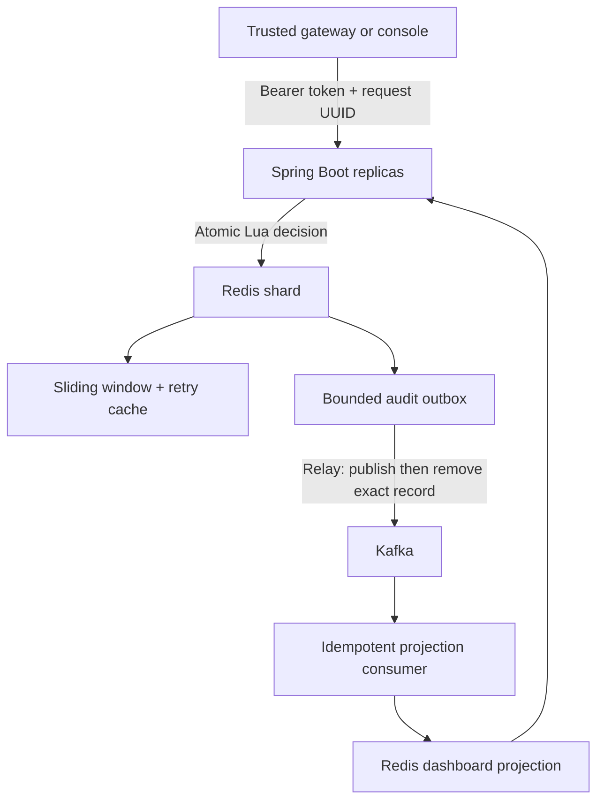

# Quota Forge

**Distributed admission control with an atomic Redis audit outbox.** Java 21 · Spring Boot · Redis · Kafka · React/TypeScript

[](https://github.com/Karthikvk1899/quota-forge/actions/workflows/ci.yml)

Quota Forge answers a practical question: **can this subject perform one more operation right now, and can we audit that decision even if Kafka is unavailable?** It is an admission-control service for trusted gateways and backend callers, not a reverse proxy. Use it for checkout attempts, expensive exports, or third-party API budgets.

Ledger Bridge reconciles events after they happen. Quota Forge controls admission before work begins and asynchronously materializes its decision history.

## Architecture



* **Exact sliding window:** a sorted set contains accepted request IDs in `(now-window, now]`; Redis TIME supplies the clock. Denials do not spend permits. Entries expire.
* **Atomic decision + outbox:** one script prunes, decides, caches the result and appends the event. Redis Cluster hash tags place all keys touched by that script in one slot. Sixteen logical shards distribute subjects.
* **Retry safety:** request UUIDs are scoped to the subject. The original decision is returned for twice the window duration, including denials. A new logical attempt needs a new UUID.
* **At-least-once delivery:** remove an outbox record only after Kafka acknowledges it. Concurrent relays may duplicate events, but exact-payload removal cannot discard someone else's unsent record.
* **Idempotent projection:** event UUID deduplication and counters/list updates are atomic. Dedup TTL is eight days; Kafka retention is seven days. This is a bounded guarantee, not unlimited exactly-once processing.
* **Backpressure:** a full shard outbox returns 503 before spending a permit. Cached retries remain available. Redis outages fail closed.
* **Policy drift protection:** each shard records its first limit/window pair. A replica with different settings fails closed; policy changes require a controlled migration.

## Run locally

Requires Docker Engine with Compose v2. The single-node topology is for local development.

```bash
git clone https://github.com/Karthikvk1899/quota-forge.git
cd quota-forge
export QUOTA_API_KEY="$(openssl rand -hex 32)"
docker compose up --build -d
```

Open **http://localhost:8080**. Paste your local `QUOTA_API_KEY` into the console. It stays in browser memory, never localStorage. The API defaults to **100 permits per subject per 60 seconds**. Kafka runs in KRaft mode; ZooKeeper is unnecessary. Kafka and Redis are not exposed on host ports.

```bash
curl -i http://localhost:8080/api/decisions \
  -H "Authorization: Bearer $QUOTA_API_KEY" \
  -H 'Content-Type: application/json' \
  -d '{"subject":"checkout/customer-42","requestId":"a6d5a871-270a-4e77-b10a-bbf452cba237"}'
```

Repeat the same body to replay the original decision. Use a new UUID for a new attempt. **200** means admitted, **429** means quota denied, **503** means unavailable. A 200 is a permit, not proof that downstream work completed. The caller must separately make downstream effects idempotent and must never execute an operation twice merely because a permit was replayed.

| Endpoint | Purpose |
|---|---|
| `POST /api/decisions` | Admit one operation; body: subject and UUID requestId |
| `GET /api/dashboard` | Policy, audited totals, sixteen outbox depths, recent 100 events |
| `GET /actuator/health` | Health endpoint; exposed internally without credentials |
| `GET /actuator/prometheus` | Authenticated internal metrics |

429 responses contain `Retry-After` (rounded up to seconds), `X-RateLimit-Limit`, and `X-RateLimit-Remaining`. Cached retries preserve the original retry interval; it is conservative, not a newly calculated countdown. Dashboard totals reflect consumed unique audit events; Prometheus request counters include retries.

## Verification and delivery

```bash
mvn verify                     # Java 21 + Maven 3.9+ + Docker required
cd ui && npm ci && npm run build # Node 22
```

Testcontainers launches real Redis and Kafka. Tests exercise contention, subject isolation, retry deduplication, window expiry, policy conflicts, backlog refusal, Kafka delivery/replay, and HTTP authentication/validation/429 headers. No integration tests are silently skipped when Docker is absent.

GitHub Actions runs integration tests, TypeScript/build, Compose validation and both image builds. Version tags publish backend and console images to GHCR **only after verification succeeds**, with provenance and SBOM metadata. Cloud deployment is deliberately not wired to an unspecified AWS account.

## Operational boundaries

This repository supplies functional implementation and automated verification, not a claim of production certification or measured throughput. Read [the failure model and deployment runbook](docs/OPERATIONS.md) before production use. In particular: Redis primary failover can lose acknowledged state, clocks can step, Lua errors do not roll back prior writes, and an unbounded number of subjects or dedup keys can exhaust memory. Set capacity and retention from measured traffic.

See [security guidance](SECURITY.md) and [contributing](CONTRIBUTING.md).

MIT license · Karthik Beesa
